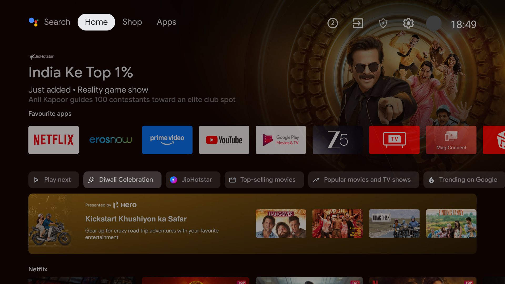
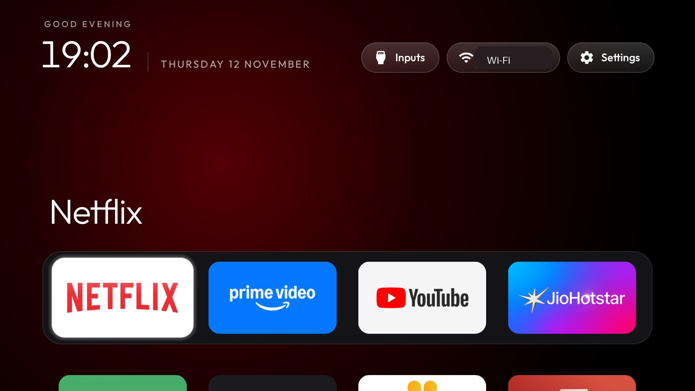
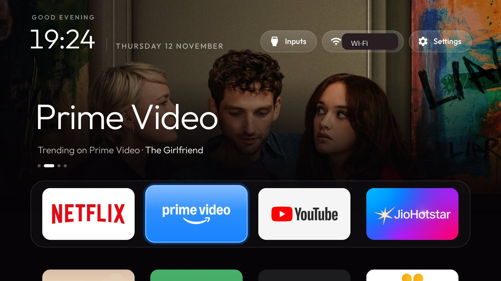
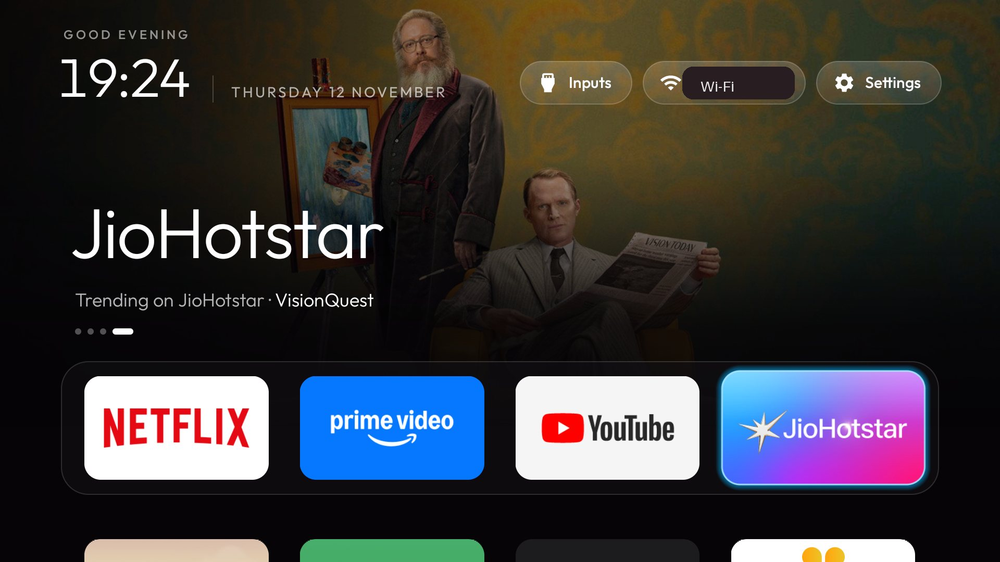
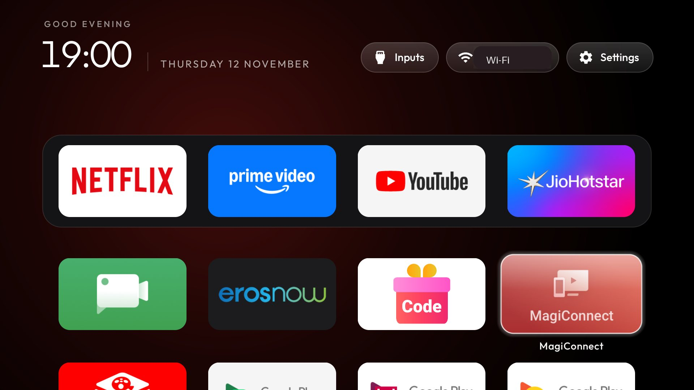
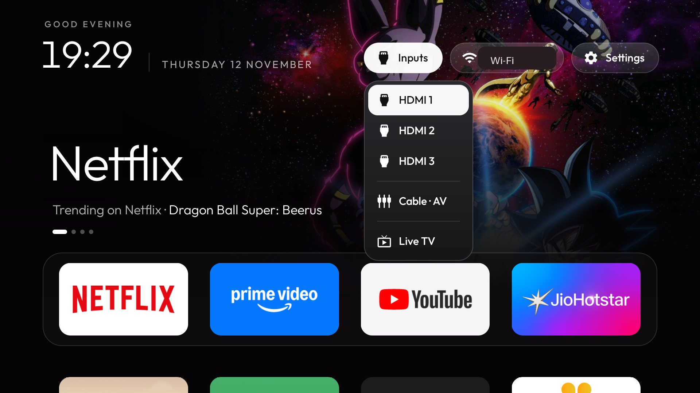

# TCL Android TV debloat

A TCL / iFFALCON Android TV cleaned up over Wi-Fi: ad rows, telemetry and preloaded bloat disabled, the stock home replaced with an Apple TV-style launcher whose top shelf shows what is trending on each streaming app, aerial videos as the screensaver, and ad-blocking DNS switched on. No root, nothing flashed, nothing uninstalled from the system, and one script puts everything back.

| Before: stock home with sponsored rows | After: trending on Netflix |
|---|---|
|  |  |
|  |  |
|  |  |

Built on [Gathin23/cleanyourtv](https://github.com/Gathin23/cleanyourtv): the launcher in `launcher/` and the scripts in `tools/` are theirs (MIT). This project configures them for one TV and adds the trending shelf, the batch lists, `rollback.sh` and this write-up.

## The TV

| | |
|---|---|
| Model | TCL `BeyondTV` (Realtek RTD2851) |
| Android | Android TV 9 (API 28), build `PPR1.180610.011`, incremental `AP08` |
| Client type | `TCL-AP-RT2851-S1` (India) |
| Stock home | `com.google.android.tvlauncher` |

Other firmware needs its own list. Check `getprop ro.build.version.incremental` before reusing these batches.

## What was changed

**19 packages disabled** with `pm disable-user --user 0`, in four batches with a screenshot after each:

| Batch | Packages | Why |
|---|---|---|
| [`01-telemetry`](batches/01-telemetry.txt) | 5 | TCL analytics, Google feedback and bug-report uploaders, partner attribution |
| [`02-ads-promos`](batches/02-ads-promos.txt) | 7 | TCL home promotions, TCL Channel feed, message box, T-key promo page, Google recommendation rows |
| [`03-preloads`](batches/03-preloads.txt) | 4 | Agreement screens, TCL's unused WebView, Stan and Rakuten TV (neither offered in India) |
| [`04-after-launcher`](batches/04-after-launcher.txt) | 3 | Stock home, TCL cleaner, TCL app store. Applied only once the new launcher was Home |

**Launcher:** the cleanyourtv reference launcher (`com.gathin.tvhome`) with a four-app dock (Netflix, Prime Video, YouTube, JioHotstar), `com.tcl.tv` as the Live TV entry in the Inputs menu, the cinematic top shelf switched on, and the trending shelf described below.

**Screensaver:** [Aerial Views](https://github.com/theothernt/AerialViews) 1.8.5 replaces Google Backdrop.

**DNS:** Android Private DNS set to `dns.adguard-dns.com`. It blocks ad and tracker domains for every app. It does not block YouTube ads.

**Left alone on purpose:** Netflix, Prime Video, JioHotstar, YouTube, ZEE5, Chromecast, Miracast and T-Cast, the Google voice assistant, the firmware updater, Live TV, HDMI inputs, the remote and Bluetooth services, the keyboard, Play Store and Play Services.

## Trending shelf

Highlight a streaming app in the dock and the top of the screen shows the artwork and name of a title that is trending on that service in India. It moves to the next title every 12 seconds, eight titles per app (four series, four films). YouTube and other apps keep the plain shelf with the app's own colour.

How it works ([`Trending.java`](launcher/app/src/main/java/com/gathin/tvhome/Trending.java), 400 lines, no new dependencies):

- **Source:** [TMDB](https://www.themoviedb.org/)'s `discover` endpoint, once for series and once for films per app, filtered by `watch_region=IN` and the service's watch-provider id, limited to titles from the last 18 months, sorted by TMDB popularity.
- **What "trending" means here:** TMDB's own measure of current interest among recent titles the service carries in that country. It is not Netflix's, Amazon's or JioHotstar's own chart.
- **Network use:** the lists and backdrops (1280 px wide) are fetched at most twice a day and cached in the app's private storage, so Home shows them at once after a restart. Failed requests are retried, because the network here reset some connections to TMDB.
- **Display only:** pressing OK still opens the app, not the title.
- **Permission:** this is the one change that gives the launcher the `INTERNET` permission, which the upstream launcher deliberately does not have. With `trending_shelf` set to `false`, or built without a key, it never opens a connection.

Settings in [`config.xml`](launcher/app/src/main/res/values/config.xml):

| Key | Default here | Meaning |
|---|---|---|
| `trending_shelf` | `true` | Master switch |
| `trending_region` | `IN` | Country whose catalogues are used |
| `trending_providers` | Netflix `8`, Prime Video `119`, JioHotstar `2336` | `package=TMDB provider id`, one per dock app |
| `trending_rotate_seconds` | `12` | Time each title stays up |
| `trending_art` | `90` | Opacity of the backdrop, 0 to 100 |

### TMDB key

The shelf needs a free TMDB API key, and the key is never committed:

1. Create an account at themoviedb.org, then Settings → API → request a key (free for personal use).
2. Copy [`launcher/tmdb.properties.example`](launcher/tmdb.properties.example) to `launcher/tmdb.properties` and put the **API Key** (the short v3 one) after `tmdb.key=`.
3. Build and install the launcher. The key is compiled into your own APK; `launcher/tmdb.properties` is in `.gitignore`.

This product uses the TMDB API but is not endorsed or certified by TMDB. Artwork in the screenshots belongs to its respective owners.

## Screensaver

Aerial Views plays the Apple TV aerial videos (cities, landscapes, underwater, space) plus Amazon's ambient videos and Jetson Creative's community videos. It was installed from the project's GitHub release, with the download checked against the SHA-256 that GitHub publishes for the file.

- **It changes every time:** shuffle is on, and the three sources add up to 244 videos (139 Apple, 85 Amazon, 20 community), all streamed from the internet (Apple's at 1080p HEVC).
- **New videos** arrive with new versions of the app. There is no "trending screensaver" feed to subscribe to; to refresh the catalogue, install the newer release the same way.
- **Starts after** 2 minutes without a button press (`screen_off_timeout`, 5 minutes originally).
- **Change it** from the Aerial Views tile on Home: sources, quality, clock and location overlays, and the playlist options.

```bash
tools/tv.py 'settings put secure screensaver_components com.neilturner.aerialviews/.ui.screensaver.DreamActivity'
```

Aerial Views is a separate open-source project with its own licence; its APK is not part of this repository.

## Verified on the TV

- After every batch: Home still opens, Wi-Fi stays up, no new crash in `logcat -b crash`.
- YouTube and Netflix launch with Private DNS on.
- The launcher's dock, app grid and Inputs menu (HDMI 1 to 3, AV, Live TV) respond to the D-pad.
- After a reboot: the launcher is Home, all 19 packages are still disabled, Private DNS is still on.
- Trending shelf: titles and artwork load for Netflix, Prime Video and JioHotstar, rotate, and come back from the cache after the launcher is force-stopped and started again. The launcher's 316 unit tests pass.
- Screensaver: Aerial Views starts by itself once the idle time is up (timed at both 5 and 2 minutes), and the owner confirmed the video plays on the TV.

Not tested: HDMI picture with a source connected, tuner reception, standby over several days, a firmware update, and a real run of `rollback.sh` (only its dry run). The aerial video cannot be screenshotted, because the TV's hardware video layer is not captured.

## Do it on the same TV model

On the TV: Settings → Device Preferences → About → press OK on **Build** seven times, then Developer options → **USB debugging** on. The TV and the computer must be on the same network.

```bash
python3 -m venv tools/venv && tools/venv/bin/pip install -r tools/requirements.txt
```

```bash
export TV_HOST=<tv ip>
```

Accept the "Allow USB debugging?" prompt on the TV, then apply the first three batches one at a time and look at the TV between them:

```bash
tools/disable.sh batches/01-telemetry.txt
```

```bash
tools/disable.sh batches/02-ads-promos.txt
```

```bash
tools/disable.sh batches/03-preloads.txt
```

Add the TMDB key (see above), then build and install the launcher (JDK 17 or 21, Android SDK platform 34 and build-tools 34.0.0). The script starts the launcher, then disables the stock home and hands Home over, and puts the stock home back if that fails:

```bash
launcher/build-and-install.sh
```

```bash
tools/disable.sh batches/04-after-launcher.txt
```

Optional ad-blocking DNS:

```bash
tools/tv.py 'settings put global private_dns_specifier dns.adguard-dns.com'
```

```bash
tools/tv.py 'settings put global private_dns_mode hostname'
```

When you are done, switch USB debugging off again on the TV and check that the port is closed:

```bash
tools/adb-closed.py <tv ip>
```

## Rolling back

Everything, in one command (needs USB debugging on):

```bash
TV_HOST=<tv ip> ./rollback.sh
```

It re-enables every package from the batches, hands Home back to the stock launcher, removes the custom launcher only after that worked, restores Private DNS and the accessibility settings, puts Google Backdrop and the 5-minute idle time back and removes Aerial Views, reboots, and prints PASS or FAIL for each check. Packages that were already disabled before this project ([`original-disabled.txt`](original-disabled.txt)) stay disabled.

| Command | What it does |
|---|---|
| `./rollback.sh --dry-run` | Prints every command, sends nothing to the TV |
| `./rollback.sh --batch 02` | Re-enables only the packages of batch 02 |
| `./rollback.sh --no-reboot` | Full rollback without the final reboot |

Smaller undos:

- **One app:** `tools/tv.py 'pm enable --user 0 <package>'`, or on the TV: Settings → Apps → See all apps → Show system apps → the app → Enable.
- **DNS only:** `tools/tv.py 'settings put global private_dns_mode opportunistic'`.
- **Trending shelf only:** set `trending_shelf` to `false` in `config.xml` and install the launcher again.
- **Screensaver only:** `tools/tv.py 'settings put secure screensaver_components com.google.android.backdrop/.Backdrop'`.
- **T button on the remote:** its page lives in `com.tcl.partnercustomizer` (batch 02). Re-enable that package to get it back.
- **No computer at hand:** a factory reset from the TV's settings undoes everything, because nothing was uninstalled or flashed.

## Changing the dock or the look

Edit `dock_apps` (order and apps) and `columns` (4 to 7) in [`config.xml`](launcher/app/src/main/res/values/config.xml), then run `launcher/build-and-install.sh` again. The same file holds the wallpaper, greeting and clock options; each key is documented in place. A new streaming app in the dock gets a trending shelf once its `package=provider id` line is added to `trending_providers`.

## Privacy

- `backup/` (the TV's package lists, properties and settings), raw screenshots and the TMDB key stay out of the repository. The published screenshots have the Wi-Fi name and the account avatar masked.
- The install script grants the launcher the location permission, which Android requires before an app may read the Wi-Fi name shown in the top bar.
- The launcher contacts two hosts only, `api.themoviedb.org` and `image.tmdb.org`, and sends nothing but the query described above with the API key.
- Aerial Views streams from Apple's, Amazon's and its community sources' servers, and its release build requests Google's advertising-ID and install-referrer permissions.

## Licence

MIT. The launcher and `tools/` are © Gathin and the cleanyourtv contributors; see [LICENSE](LICENSE). The launcher's font and icons carry their own licences in [`launcher/`](launcher/).
